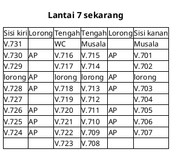
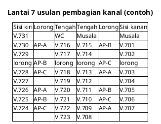
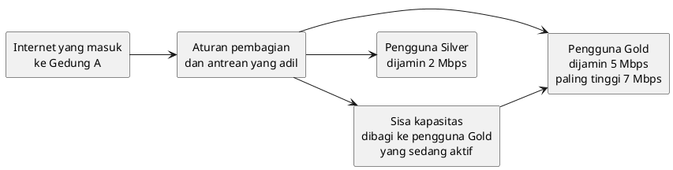
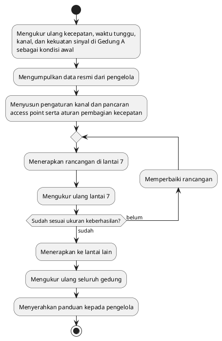

# Perancangan

Bab ini menjelaskan rancangan perbaikan untuk dua masalah utama: sinyal access point yang belum sampai merata ke semua ruang kelas, dan pembagian internet yang belum memberi pengguna kecepatan sesuai paketnya. Rancangan di sini masih rancangan awal. Angka dan pengaturan akhirnya baru ditetapkan setelah pengukuran ulang dan data resmi dari pengelola didapat.

## Arti optimasi dalam proyek ini

Optimasi berarti memaksimalkan apa yang sudah dimiliki kampus. Proyek ini tidak membeli tambahan kapasitas internet dan tidak mengutamakan pemindahan access point. Yang diubah adalah cara perangkat yang sudah ada bekerja, yaitu dua hal:

1. **Pengaturan access point**, supaya sinyal sampai merata ke semua ruang kelas dan access point yang berdekatan tidak saling mengganggu.
2. **Aturan pembagian kecepatan internet**, supaya setiap pengguna mendapat kecepatan sesuai paket yang ia bayar dan internet tetap responsif, termasuk pada jam ramai.

Karena yang diubah adalah pengaturan, proyek ini hampir tidak membutuhkan pembelian perangkat. Biaya terbesarnya ada pada tenaga dan waktu untuk mengukur, mengatur, dan mengukur ulang.

## Rancangan 1: Penataan sinyal tanpa memindahkan alat

### Kondisi sekarang

Gambar berikut adalah denah lantai 7 Gedung A yang disederhanakan dari denah buatan tim. Kotak bertuliskan AP menandai letak access point.

Dua belas access point di lantai ini tersebar cukup merata di sepanjang dua lorong. Jumlah dan letaknya tidak menjadi masalah utama. Memindahkannya akan membutuhkan biaya kabel dan tenaga pasang, padahal manfaatnya belum terbukti.

Yang patut dicurigai adalah cara access point itu diatur. Access point bekerja seperti orang yang berbicara di satu ruangan. Kalau dua orang yang berdekatan bicara dengan nada yang sama, suara mereka saling menimpa dan sulit didengar. Nada ini disebut kanal. Pada jalur 2,4 GHz, yang dipakai sebagian besar HP, hanya ada tiga kanal yang tidak saling bertabrakan. Dengan 12 access point di satu lantai, ditambah access point di lantai bawahnya, access point yang bersebelahan sangat mungkin memakai kanal yang sama.

Kami belum sempat memeriksa kanal yang dipakai setiap access point. Karena itu, hal ini masih dugaan yang akan diperiksa pada pengukuran awal proyek.

### Usulan pengaturan

Rancangan ini memakai tiga pengaturan, tanpa memindahkan access point:

1. **Kanal yang berbeda untuk access point yang bersebelahan.** Setiap access point diberi kanal yang berbeda dari tetangganya, baik yang di lorong yang sama maupun yang berseberangan.
2. **Kekuatan pancaran yang disesuaikan.** Access point yang terdekat dengan ruang pojok, seperti V.731, dikuatkan pancarannya. Access point yang terlalu berdekatan diturunkan pancarannya supaya tidak saling menimpa.
3. **HP diarahkan ke jalur yang lebih lega.** Selain jalur 2,4 GHz, access point juga punya jalur 5 GHz yang punya lebih banyak kanal dan lebih jarang padat. HP yang mendukung jalur ini diarahkan ke sana, dan HP otomatis berpindah ke access point terdekat saat sinyalnya melemah.

Gambar berikut adalah contoh pembagian kanal untuk lantai 7. Huruf A, B, dan C menandai tiga kanal yang berbeda. Tidak ada dua access point bersebelahan yang memakai huruf yang sama.

Pembagian di atas masih contoh. Pembagian akhir ditentukan dari hasil pemeriksaan kanal dan kekuatan sinyal di setiap ruang, termasuk gangguan dari access point di lantai 6.

Kalau setelah pengaturan ini masih ada ruang yang kecepatannya di bawah janji paket, barulah memindahkan atau menambah access point dipertimbangkan, khusus untuk ruang tersebut. Langkah ini menjadi cadangan, bukan rencana utama.

## Rancangan 2: Aturan pembagian kecepatan internet

Internet yang masuk ke Gedung A jumlahnya terbatas dan dipakai bersama. Saat ramai, tanpa aturan yang jelas, pengguna yang sedang mengunduh file besar bisa memakan jatah pengguna lain. Rancangan ini memakai empat aturan:

1. **Jatah terjamin.** Setiap pengguna dijamin mendapat kecepatan paling rendah sesuai paketnya: 2 Mbps untuk Silver dan 5 Mbps untuk Gold.
2. **Batas atas.** Setiap pengguna dibatasi paling tinggi sesuai paketnya: 2 Mbps untuk Silver dan 7 Mbps untuk Gold. Dengan begitu, tidak ada satu pengguna yang menghabiskan jatah orang lain.
3. **Sisa dibagi rata.** Kalau masih ada sisa kapasitas, misalnya saat sepi, sisa itu dibagi ke pengguna Gold yang sedang aktif sampai batas atasnya.
4. **Antrean yang adil.** Saat jatah seorang pengguna sedang penuh, data yang menunggu tidak dibiarkan menumpuk. Permintaan kecil, seperti membuka halaman atau mengirim pesan, didahulukan dari unduhan besar. Hasilnya, internet tetap terasa responsif walaupun kecepatannya dibatasi.

Aturan keempat berangkat dari data di bab analisis masalah. Saat ramai, pengguna Silver harus menunggu 824 sampai 2.491 milidetik untuk mendapat balasan, sedangkan pengguna Gold hanya 14 milidetik. Pola ini menunjukkan antrean data yang menumpuk di jalur pengguna Silver.

Kami belum tahu cara pembagian yang dipakai kampus saat ini. Karena itu, pada tahap percontohan, tim akan membandingkan cara pembagian yang berlaku sekarang dengan cara antrean yang lebih baru di lantai yang sama, lalu memilih yang hasilnya lebih baik.

Aturan ini juga hanya bisa berjalan kalau kapasitas internet gedung cukup untuk semua jatah terjamin pada jam ramai. Sebelum aturan diterapkan, tim akan membandingkan dua angka: kapasitas internet yang masuk ke Gedung A, dan jumlah seluruh jatah terjamin saat pengguna paling banyak. Kalau kapasitasnya ternyata tidak cukup, tim akan melaporkan hitungan itu kepada kampus sebagai bahan pertimbangan menambah kapasitas. Penambahan kapasitas itu sendiri berada di luar proyek ini.

## Alur pengerjaan

Perbaikan tidak langsung diterapkan ke seluruh gedung. Lantai 7 dipakai sebagai percontohan karena denahnya sudah ada dan ruang pojoknya terbukti bermasalah. Kalau hasilnya sesuai ukuran keberhasilan, perbaikan diterapkan ke lantai lain.

Dengan cara ini, kalau ada rancangan yang tidak berhasil, kesalahannya hanya terjadi di satu lantai dan bisa diperbaiki sebelum menyebar ke seluruh gedung. Karena yang diubah hanya pengaturan, pengaturan lama juga bisa dikembalikan kapan saja.

## Hubungan masalah dan rancangan

| Masalah                                                                               | Rancangan                                               | Tanda berhasil                                                              |
| ------------------------------------------------------------------------------------- | ------------------------------------------------------- | --------------------------------------------------------------------------- |
| Ruang pojok seperti V.731 mendapat kecepatan di bawah janji walaupun gedung sepi      | Pengaturan kanal dan kekuatan pancaran access point     | Ruang yang jauh dari access point mendapat kecepatan sesuai paket           |
| Saat ramai, pengguna Gold dan Silver tidak mendapat kecepatan sesuai paket            | Aturan jatah terjamin, batas atas, dan sisa dibagi rata | Pada jam ramai, Gold paling sedikit 5 Mbps dan Silver paling sedikit 2 Mbps |
| Saat ramai, pengguna Silver menunggu hampir 1 sampai 2,5 detik untuk mendapat balasan | Antrean yang adil                                       | Waktu tunggu saat ramai di bawah 100 milidetik                              |
| Koneksi putus dan halaman lambat termuat saat kuliah                                  | Kedua rancangan di atas                                 | Koneksi tidak putus selama satu sesi kuliah                                 |

## Catatan untuk lampiran teknis

Bagian ini tidak masuk badan proposal dan dipindahkan ke lampiran saat proposal disusun.

- Pembagian kanal pada jalur 2,4 GHz memakai kanal 1, 6, dan 11 (huruf A, B, dan C pada denah). Pada jalur 5 GHz, kanal dipilih dari kanal yang tersedia dan tidak bertumpuk.
- Pengaturan kanal, kekuatan pancaran, dan pengarahan ke 5 GHz dilakukan dari pengaturan pusat access point. Access point yang terlihat di lantai 7 bermerek Ruijie.
- Antrean yang adil mengacu pada metode antrean modern seperti fq_codel atau CAKE. Metode ini dibandingkan dengan cara pembagian yang berlaku sekarang, misalnya PCQ, pada tahap percontohan.
