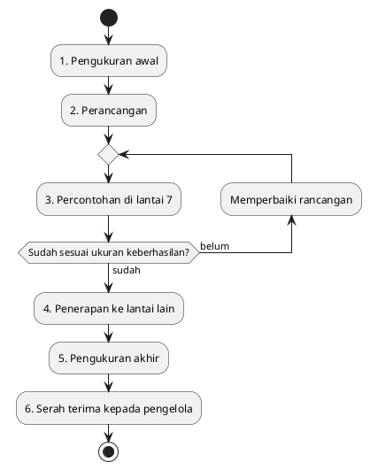

# Metode

Bab perancangan menjelaskan apa yang akan diubah. Bab ini menjelaskan bagaimana perubahan itu dikerjakan, langkah demi langkah, beserta hasil yang bisa diperiksa di setiap langkah.

## Tahapan pengerjaan

Proyek ini memakai metode NDLC (*Network Development Life Cycle*), atau siklus pengembangan jaringan. Metode ini biasa dipakai untuk proyek jaringan karena urutannya mengikuti cara kerja yang wajar: ukur dulu, rancang, coba di skala kecil, terapkan, ukur lagi, lalu serahkan. NDLC punya enam tahap. Nama aslinya adalah *analysis*, *design*, *simulation prototyping*, *implementation*, *monitoring*, dan *management*. Di proposal ini keenamnya kami sebut pengukuran awal, perancangan, percontohan, penerapan, pengukuran akhir, dan serah terima.

Setiap tahap baru dimulai setelah hasil tahap sebelumnya selesai, kecuali tahap percontohan yang boleh diulang sampai hasilnya sesuai ukuran keberhasilan.

### 1. Pengukuran awal

Tahap ini menutup kekurangan data di tahap proposal dan menjadi pembanding sebelum perbaikan.

- Mengajukan izin tertulis kepada Lembaga Pengembangan Teknologi Informasi UNPAM.
- Mewawancarai pengelola jaringan dan meminta data resmi: jumlah dan letak access point, kapasitas internet Gedung A, serta cara pembagian kecepatan yang berlaku sekarang.
- Mengukur kecepatan dan waktu tunggu di setiap lantai Gedung A, masing-masing di ruang yang dekat, sedang, dan jauh dari access point, pada jam sepi dan jam ramai.
- Memeriksa kanal setiap access point dan kekuatan sinyal di setiap ruang yang diukur.
- Menyebar kuesioner singkat kepada mahasiswa dan dosen tentang pengalaman memakai WiFi kampus.

Hasil tahap ini: laporan kondisi awal Gedung A.

### 2. Perancangan

Rancangan awal di bab perancangan disesuaikan dengan data dari tahap pertama.

- Menyusun pembagian kanal dan kekuatan pancaran untuk setiap access point.
- Menetapkan angka akhir aturan pembagian kecepatan untuk paket Silver dan Gold.
- Membandingkan kapasitas internet gedung dengan jumlah seluruh jatah terjamin pada jam ramai. Kalau tidak cukup, hitungan ini dilaporkan kepada kampus.
- Membahas rancangan bersama pengelola sampai disetujui.

Hasil tahap ini: dokumen rancangan yang disetujui pengelola.

### 3. Percontohan di lantai 7

Rancangan diuji di satu lantai lebih dulu supaya kesalahan tidak menyebar ke seluruh gedung.

- Menyimpan salinan pengaturan lama, supaya bisa dikembalikan kapan saja.
- Menerapkan pengaturan baru bersama petugas IT Support, di luar jam kuliah ramai.
- Mengukur ulang lantai 7 pada jam sepi dan jam ramai dengan cara yang sama seperti pengukuran awal.
- Membandingkan cara pembagian kecepatan yang berlaku sekarang dengan cara antrean yang lebih baru, lalu memilih yang hasilnya lebih baik.
- Kalau hasilnya belum sesuai ukuran keberhasilan, rancangan diperbaiki dan diuji lagi.

Hasil tahap ini: laporan percontohan berisi perbandingan sebelum dan sesudah di lantai 7.

### 4. Penerapan ke lantai lain

Pengaturan yang sudah terbukti di lantai 7 diterapkan ke lantai lain di Gedung A, satu per satu, dengan cara yang sama: simpan pengaturan lama, terapkan di luar jam ramai, lalu periksa cepat setelahnya.

Hasil tahap ini: seluruh access point Gedung A memakai pengaturan baru.

### 5. Pengukuran akhir

Seluruh Gedung A diukur ulang dengan cara yang sama seperti pengukuran awal, dan kuesioner disebar ulang. Hasilnya dibandingkan dengan ukuran keberhasilan di bab analisis kebutuhan:

- Pada jam ramai, Gold paling sedikit 5 Mbps dan Silver paling sedikit 2 Mbps, di ruang yang dekat maupun jauh dari access point.
- Pada jam ramai, waktu tunggu balasan di bawah 100 milidetik.
- Koneksi tidak putus selama satu sesi kuliah.

Hasil tahap ini: laporan perbandingan sebelum dan sesudah untuk seluruh gedung.

### 6. Serah terima kepada pengelola

- Menyerahkan panduan berisi pengaturan setiap access point, aturan pembagian kecepatan, dan alasannya.
- Memberi penjelasan singkat kepada petugas IT Support tentang cara memantau jumlah pengguna dan kecepatan per access point.
- Menyerahkan laporan akhir proyek.

Hasil tahap ini: panduan pengelola dan laporan akhir proyek.

## Cara mengukur yang dipakai di semua tahap

Pengalaman di tahap proposal menunjukkan bahwa hasil ukur yang memakai alat dan HP berbeda sulit dibandingkan. Karena itu, setiap pengukuran dalam proyek ini mengikuti aturan yang sama:

- HP, akun Silver dan Gold, serta situs uji yang sama untuk semua titik.
- Titik dan jam pengukuran yang sama di setiap tahap, supaya hasil sebelum dan sesudah bisa dibandingkan.
- Setiap hasil disimpan sebagai tangkapan layar yang memperlihatkan tanggal dan jam, lalu dicatat di satu tabel rekap.

## Pembagian peran

| Anggota | Peran utama |
|---|---|
| Muhammad Zirlda Prairi | Manajer proyek: izin, koordinasi dengan pengelola, pemeriksaan hasil setiap tahap |
| Rizky Zehan's Onassis | Pengukuran kecepatan, waktu tunggu, kanal, dan kekuatan sinyal |
| Dzaky Alfareza | Denah setiap lantai, penyusunan rancangan kanal dan pancaran |
| Vigie Afrilza Wibowo | Kuesioner, rekap data, dan penyusunan panduan serta laporan |

Penerapan pengaturan di tahap 3 dan 4 selalu dilakukan oleh petugas IT Support dan didampingi tim.

## Risiko dan cara menanganinya

| Risiko | Cara menangani |
|---|---|
| Izin atau data resmi tidak diberikan | Proyek dijalankan dengan data pengukuran tim sendiri, dan penolakan dicatat sebagai batasan |
| Pengaturan baru justru membuat WiFi lebih buruk | Pengaturan lama dikembalikan dari salinan yang sudah disimpan |
| Perubahan pengaturan mengganggu kuliah | Perubahan hanya dilakukan di luar jam kuliah ramai |
| Kapasitas internet gedung tidak cukup untuk semua jatah terjamin | Hitungan dilaporkan kepada kampus sebagai bahan keputusan; proyek tetap menjalankan pengaturan kanal dan antrean yang adil |
