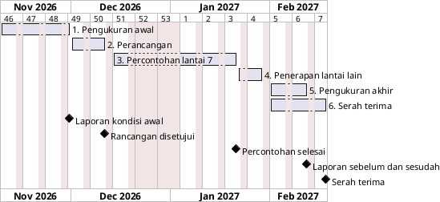

# Estimasi waktu

Bab ini memperkirakan berapa lama proyek berjalan. Semua angka di sini adalah perkiraan, bukan kepastian. Lama setiap pekerjaan bisa berubah, misalnya kalau izin dari kampus keluar lebih lambat atau rancangan perlu diperbaiki setelah percontohan.

## Cara memperkirakan

Lama setiap pekerjaan diperkirakan dengan metode PERT, atau estimasi tiga titik. Untuk setiap pekerjaan, tim menebak tiga angka:

- **Optimis**: lama pekerjaan kalau semuanya lancar.
- **Paling mungkin**: lama pekerjaan dalam keadaan biasa.
- **Pesimis**: lama pekerjaan kalau banyak hambatan.

Ketiga angka itu digabung menjadi satu perkiraan dengan rumus berikut. Angka paling mungkin diberi bobot terbesar karena paling sering terjadi.

> Perkiraan = (Optimis + 4 × Paling mungkin + Pesimis) ÷ 6

Hasilnya dibulatkan ke atas menjadi hari kerja penuh. Hari kerja dihitung Senin sampai Jumat.

## Dasar perhitungan

- Proyek dianggap mulai Senin, 9 November 2026, setelah proposal disetujui. Kalau persetujuan datang lebih lambat, seluruh jadwal bergeser dengan jumlah hari yang sama.
- Libur akhir tahun, 21 Desember 2026 sampai 1 Januari 2027, tidak dihitung sebagai hari kerja. Pada masa itu kampus sepi, sehingga jam ramai tidak bisa diukur.
- Setiap pengukuran berlangsung paling sedikit lima hari kerja berturut-turut, supaya selalu mencakup hari Selasa (ramai) dan Jumat (sepi).
- Penerapan pengaturan selalu dilakukan oleh petugas IT Support, sehingga jadwalnya ikut bergantung pada waktu luang mereka.

## Perkiraan per pekerjaan

Satuan dalam tabel adalah hari kerja. Nomor pekerjaan sama dengan nomor di WBS.

| No. | Pekerjaan                                                  | Optimis | Paling mungkin | Pesimis | Perkiraan | Dibulatkan |
| --- | ---------------------------------------------------------- | ------- | -------------- | ------- | --------- | ---------- |
| 1.1 | Pengajuan izin ke Lembaga Pengembangan Teknologi Informasi | 2       | 5              | 10      | 5,33      | 6          |
| 1.2 | Penyiapan alat dan aturan pengukuran                       | 1       | 2              | 3       | 2,00      | 2          |
| 1.3 | Wawancara pengelola dan permintaan data resmi              | 2       | 3              | 6       | 3,33      | 4          |
| 1.4 | Pengukuran kecepatan dan waktu tunggu semua lantai         | 5       | 5              | 10      | 5,83      | 6          |
| 1.5 | Pemeriksaan kanal dan kekuatan sinyal                      | 2       | 3              | 5       | 3,17      | 4          |
| 1.6 | Penyebaran dan penutupan kuesioner                         | 5       | 5              | 10      | 5,83      | 6          |
| 1.7 | Penyusunan laporan kondisi awal                            | 2       | 3              | 5       | 3,17      | 4          |
| 2.1 | Penyusunan pembagian kanal dan kekuatan pancaran           | 2       | 3              | 5       | 3,17      | 4          |
| 2.2 | Penetapan aturan pembagian kecepatan dan antrean           | 1       | 2              | 4       | 2,17      | 3          |
| 2.3 | Pemeriksaan kapasitas internet terhadap jatah terjamin     | 1       | 1              | 2       | 1,17      | 2          |
| 2.4 | Pembahasan dan persetujuan rancangan                       | 2       | 3              | 7       | 3,50      | 4          |
| 3.1 | Penyimpanan salinan pengaturan lama lantai 7               | 1       | 1              | 1       | 1,00      | 1          |
| 3.2 | Penerapan pengaturan kanal dan pancaran di lantai 7        | 1       | 1              | 2       | 1,17      | 2          |
| 3.3 | Penerapan aturan pembagian kecepatan di lantai 7           | 1       | 2              | 3       | 2,00      | 2          |
| 3.4 | Pengukuran ulang lantai 7, cara lama dan cara baru         | 5       | 10             | 15      | 10,00     | 10         |
| 3.5 | Evaluasi percontohan dan perbaikan rancangan               | 1       | 3              | 8       | 3,50      | 4          |
| 4.1 | Penyimpanan salinan pengaturan lama lantai 1 sampai 6      | 1       | 1              | 2       | 1,17      | 2          |
| 4.2 | Penerapan pengaturan baru di lantai 1 sampai 6             | 2       | 3              | 5       | 3,17      | 4          |
| 4.3 | Pemeriksaan cepat tiap lantai                              | 2       | 3              | 5       | 3,17      | 4          |
| 5.1 | Pengukuran akhir seluruh gedung                            | 5       | 5              | 10      | 5,83      | 6          |
| 5.2 | Penyebaran ulang kuesioner                                 | 5       | 5              | 10      | 5,83      | 6          |
| 5.3 | Penyusunan laporan perbandingan sebelum dan sesudah        | 2       | 3              | 5       | 3,17      | 4          |
| 6.1 | Penyusunan panduan pengelola                               | 2       | 3              | 5       | 3,17      | 4          |
| 6.2 | Penjelasan singkat kepada IT Support                       | 1       | 1              | 2       | 1,17      | 2          |
| 6.3 | Penyusunan laporan akhir dan serah terima                  | 2       | 3              | 5       | 3,17      | 4          |

Beberapa pekerjaan berjalan bersamaan. Misalnya, pemeriksaan kanal (1.5) dan penyebaran kuesioner (1.6) dikerjakan selama pengukuran awal (1.4) berlangsung. Karena itu, lama proyek tidak sama dengan jumlah semua angka di tabel.

## Diagram PERT

Diagram berikut memperlihatkan urutan pekerjaan dalam bentuk jaringan. Setiap kotak adalah satu pekerjaan, dan anak panah menunjukkan pekerjaan mana yang harus selesai lebih dulu. Panah bertuliskan SS berarti kedua pekerjaan mulai bersamaan.

Setiap kotak berisi enam angka dalam satuan hari kerja:

| Singkatan | Arti                                                                                      |
| --------- | ----------------------------------------------------------------------------------------- |
| ES        | Paling cepat mulai, dihitung sejak awal proyek                                            |
| TE        | Lama pekerjaan hasil perkiraan PERT, dibulatkan ke hari kerja penuh                       |
| EF        | Paling cepat selesai (ES + TE)                                                            |
| LS        | Paling lambat mulai tanpa menunda proyek                                                  |
| LF        | Paling lambat selesai tanpa menunda proyek                                                |
| TF        | Waktu longgar (LS − ES). Kalau nilainya 0, pekerjaan itu tidak boleh terlambat sehari pun |

Kotak berwarna merah muda dan panah merah tebal adalah jalur kritis, yaitu pekerjaan dengan waktu longgar 0. Keterlambatan di jalur ini langsung menggeser tanggal selesai proyek.

```plantuml
@startuml Diagram_PERT
skinparam shadowing false
skinparam defaultFontName Arial
skinparam defaultFontSize 11
skinparam rectangle {
  BackgroundColor #FFFFFF
  BorderColor #333333
  RoundCorner 0
}
skinparam ArrowColor #555555
top to bottom direction
skinparam defaultTextAlignment center
skinparam nodesep 25
skinparam ranksep 40
title Diagram PERT (activity-on-node)\nKotak: ES | TE | EF (atas), LS | TF | LF (bawah), dalam hari kerja; merah muda = jalur kritis; SS = mulai bersamaan
rectangle "MULAI" as START #EEEEEE
rectangle "SELESAI" as FINISH #EEEEEE
rectangle "<b>1.1 Pengajuan izin</b>\n|<color:#F8CECC>00</color><b>ES</b><color:#F8CECC>00</color>|<color:#F8CECC>00</color><b>TE</b><color:#F8CECC>00</color>|<color:#F8CECC>00</color><b>EF</b><color:#F8CECC>00</color>|\n|<color:#F8CECC>000</color>0<color:#F8CECC>000</color>|<color:#F8CECC>000</color>6<color:#F8CECC>000</color>|<color:#F8CECC>000</color>6<color:#F8CECC>000</color>|\n|<color:#F8CECC>00</color><b>LS</b><color:#F8CECC>00</color>|<color:#F8CECC>00</color><b>TF</b><color:#F8CECC>00</color>|<color:#F8CECC>00</color><b>LF</b><color:#F8CECC>00</color>|\n|<color:#F8CECC>000</color>0<color:#F8CECC>000</color>|<color:#F8CECC>000</color>0<color:#F8CECC>000</color>|<color:#F8CECC>000</color>6<color:#F8CECC>000</color>|" as N1_1 #F8CECC
rectangle "<b>1.2 Penyiapan alat ukur</b>\n|<color:#FFFFFF>00</color><b>ES</b><color:#FFFFFF>00</color>|<color:#FFFFFF>00</color><b>TE</b><color:#FFFFFF>00</color>|<color:#FFFFFF>00</color><b>EF</b><color:#FFFFFF>00</color>|\n|<color:#FFFFFF>000</color>0<color:#FFFFFF>000</color>|<color:#FFFFFF>000</color>2<color:#FFFFFF>000</color>|<color:#FFFFFF>000</color>2<color:#FFFFFF>000</color>|\n|<color:#FFFFFF>00</color><b>LS</b><color:#FFFFFF>00</color>|<color:#FFFFFF>00</color><b>TF</b><color:#FFFFFF>00</color>|<color:#FFFFFF>00</color><b>LF</b><color:#FFFFFF>00</color>|\n|<color:#FFFFFF>000</color>4<color:#FFFFFF>000</color>|<color:#FFFFFF>000</color>4<color:#FFFFFF>000</color>|<color:#FFFFFF>000</color>6<color:#FFFFFF>000</color>|" as N1_2
rectangle "<b>1.3 Wawancara pengelola</b>\n|<color:#FFFFFF>00</color><b>ES</b><color:#FFFFFF>00</color>|<color:#FFFFFF>00</color><b>TE</b><color:#FFFFFF>00</color>|<color:#FFFFFF>00</color><b>EF</b><color:#FFFFFF>00</color>|\n|<color:#FFFFFF>000</color>6<color:#FFFFFF>000</color>|<color:#FFFFFF>000</color>4<color:#FFFFFF>000</color>|<color:#FFFFFF>00</color>10<color:#FFFFFF>000</color>|\n|<color:#FFFFFF>00</color><b>LS</b><color:#FFFFFF>00</color>|<color:#FFFFFF>00</color><b>TF</b><color:#FFFFFF>00</color>|<color:#FFFFFF>00</color><b>LF</b><color:#FFFFFF>00</color>|\n|<color:#FFFFFF>000</color>8<color:#FFFFFF>000</color>|<color:#FFFFFF>000</color>2<color:#FFFFFF>000</color>|<color:#FFFFFF>00</color>12<color:#FFFFFF>000</color>|" as N1_3
rectangle "<b>1.4 Pengukuran awal</b>\n|<color:#F8CECC>00</color><b>ES</b><color:#F8CECC>00</color>|<color:#F8CECC>00</color><b>TE</b><color:#F8CECC>00</color>|<color:#F8CECC>00</color><b>EF</b><color:#F8CECC>00</color>|\n|<color:#F8CECC>000</color>6<color:#F8CECC>000</color>|<color:#F8CECC>000</color>6<color:#F8CECC>000</color>|<color:#F8CECC>00</color>12<color:#F8CECC>000</color>|\n|<color:#F8CECC>00</color><b>LS</b><color:#F8CECC>00</color>|<color:#F8CECC>00</color><b>TF</b><color:#F8CECC>00</color>|<color:#F8CECC>00</color><b>LF</b><color:#F8CECC>00</color>|\n|<color:#F8CECC>000</color>6<color:#F8CECC>000</color>|<color:#F8CECC>000</color>0<color:#F8CECC>000</color>|<color:#F8CECC>00</color>12<color:#F8CECC>000</color>|" as N1_4 #F8CECC
rectangle "<b>1.5 Pemeriksaan kanal & sinyal</b>\n|<color:#FFFFFF>00</color><b>ES</b><color:#FFFFFF>00</color>|<color:#FFFFFF>00</color><b>TE</b><color:#FFFFFF>00</color>|<color:#FFFFFF>00</color><b>EF</b><color:#FFFFFF>00</color>|\n|<color:#FFFFFF>000</color>6<color:#FFFFFF>000</color>|<color:#FFFFFF>000</color>4<color:#FFFFFF>000</color>|<color:#FFFFFF>00</color>10<color:#FFFFFF>000</color>|\n|<color:#FFFFFF>00</color><b>LS</b><color:#FFFFFF>00</color>|<color:#FFFFFF>00</color><b>TF</b><color:#FFFFFF>00</color>|<color:#FFFFFF>00</color><b>LF</b><color:#FFFFFF>00</color>|\n|<color:#FFFFFF>000</color>8<color:#FFFFFF>000</color>|<color:#FFFFFF>000</color>2<color:#FFFFFF>000</color>|<color:#FFFFFF>00</color>12<color:#FFFFFF>000</color>|" as N1_5
rectangle "<b>1.6 Kuesioner pengguna</b>\n|<color:#F8CECC>00</color><b>ES</b><color:#F8CECC>00</color>|<color:#F8CECC>00</color><b>TE</b><color:#F8CECC>00</color>|<color:#F8CECC>00</color><b>EF</b><color:#F8CECC>00</color>|\n|<color:#F8CECC>000</color>6<color:#F8CECC>000</color>|<color:#F8CECC>000</color>6<color:#F8CECC>000</color>|<color:#F8CECC>00</color>12<color:#F8CECC>000</color>|\n|<color:#F8CECC>00</color><b>LS</b><color:#F8CECC>00</color>|<color:#F8CECC>00</color><b>TF</b><color:#F8CECC>00</color>|<color:#F8CECC>00</color><b>LF</b><color:#F8CECC>00</color>|\n|<color:#F8CECC>000</color>6<color:#F8CECC>000</color>|<color:#F8CECC>000</color>0<color:#F8CECC>000</color>|<color:#F8CECC>00</color>12<color:#F8CECC>000</color>|" as N1_6 #F8CECC
rectangle "<b>1.7 Laporan kondisi awal</b>\n|<color:#F8CECC>00</color><b>ES</b><color:#F8CECC>00</color>|<color:#F8CECC>00</color><b>TE</b><color:#F8CECC>00</color>|<color:#F8CECC>00</color><b>EF</b><color:#F8CECC>00</color>|\n|<color:#F8CECC>00</color>12<color:#F8CECC>000</color>|<color:#F8CECC>000</color>4<color:#F8CECC>000</color>|<color:#F8CECC>00</color>16<color:#F8CECC>000</color>|\n|<color:#F8CECC>00</color><b>LS</b><color:#F8CECC>00</color>|<color:#F8CECC>00</color><b>TF</b><color:#F8CECC>00</color>|<color:#F8CECC>00</color><b>LF</b><color:#F8CECC>00</color>|\n|<color:#F8CECC>00</color>12<color:#F8CECC>000</color>|<color:#F8CECC>000</color>0<color:#F8CECC>000</color>|<color:#F8CECC>00</color>16<color:#F8CECC>000</color>|" as N1_7 #F8CECC
rectangle "<b>2.1 Rancangan kanal & pancaran</b>\n|<color:#FFFFFF>00</color><b>ES</b><color:#FFFFFF>00</color>|<color:#FFFFFF>00</color><b>TE</b><color:#FFFFFF>00</color>|<color:#FFFFFF>00</color><b>EF</b><color:#FFFFFF>00</color>|\n|<color:#FFFFFF>00</color>16<color:#FFFFFF>000</color>|<color:#FFFFFF>000</color>4<color:#FFFFFF>000</color>|<color:#FFFFFF>00</color>20<color:#FFFFFF>000</color>|\n|<color:#FFFFFF>00</color><b>LS</b><color:#FFFFFF>00</color>|<color:#FFFFFF>00</color><b>TF</b><color:#FFFFFF>00</color>|<color:#FFFFFF>00</color><b>LF</b><color:#FFFFFF>00</color>|\n|<color:#FFFFFF>00</color>17<color:#FFFFFF>000</color>|<color:#FFFFFF>000</color>1<color:#FFFFFF>000</color>|<color:#FFFFFF>00</color>21<color:#FFFFFF>000</color>|" as N2_1
rectangle "<b>2.2 Rancangan pembagian kecepatan</b>\n|<color:#F8CECC>00</color><b>ES</b><color:#F8CECC>00</color>|<color:#F8CECC>00</color><b>TE</b><color:#F8CECC>00</color>|<color:#F8CECC>00</color><b>EF</b><color:#F8CECC>00</color>|\n|<color:#F8CECC>00</color>16<color:#F8CECC>000</color>|<color:#F8CECC>000</color>3<color:#F8CECC>000</color>|<color:#F8CECC>00</color>19<color:#F8CECC>000</color>|\n|<color:#F8CECC>00</color><b>LS</b><color:#F8CECC>00</color>|<color:#F8CECC>00</color><b>TF</b><color:#F8CECC>00</color>|<color:#F8CECC>00</color><b>LF</b><color:#F8CECC>00</color>|\n|<color:#F8CECC>00</color>16<color:#F8CECC>000</color>|<color:#F8CECC>000</color>0<color:#F8CECC>000</color>|<color:#F8CECC>00</color>19<color:#F8CECC>000</color>|" as N2_2 #F8CECC
rectangle "<b>2.3 Cek kapasitas internet</b>\n|<color:#F8CECC>00</color><b>ES</b><color:#F8CECC>00</color>|<color:#F8CECC>00</color><b>TE</b><color:#F8CECC>00</color>|<color:#F8CECC>00</color><b>EF</b><color:#F8CECC>00</color>|\n|<color:#F8CECC>00</color>19<color:#F8CECC>000</color>|<color:#F8CECC>000</color>2<color:#F8CECC>000</color>|<color:#F8CECC>00</color>21<color:#F8CECC>000</color>|\n|<color:#F8CECC>00</color><b>LS</b><color:#F8CECC>00</color>|<color:#F8CECC>00</color><b>TF</b><color:#F8CECC>00</color>|<color:#F8CECC>00</color><b>LF</b><color:#F8CECC>00</color>|\n|<color:#F8CECC>00</color>19<color:#F8CECC>000</color>|<color:#F8CECC>000</color>0<color:#F8CECC>000</color>|<color:#F8CECC>00</color>21<color:#F8CECC>000</color>|" as N2_3 #F8CECC
rectangle "<b>2.4 Persetujuan rancangan</b>\n|<color:#F8CECC>00</color><b>ES</b><color:#F8CECC>00</color>|<color:#F8CECC>00</color><b>TE</b><color:#F8CECC>00</color>|<color:#F8CECC>00</color><b>EF</b><color:#F8CECC>00</color>|\n|<color:#F8CECC>00</color>21<color:#F8CECC>000</color>|<color:#F8CECC>000</color>4<color:#F8CECC>000</color>|<color:#F8CECC>00</color>25<color:#F8CECC>000</color>|\n|<color:#F8CECC>00</color><b>LS</b><color:#F8CECC>00</color>|<color:#F8CECC>00</color><b>TF</b><color:#F8CECC>00</color>|<color:#F8CECC>00</color><b>LF</b><color:#F8CECC>00</color>|\n|<color:#F8CECC>00</color>21<color:#F8CECC>000</color>|<color:#F8CECC>000</color>0<color:#F8CECC>000</color>|<color:#F8CECC>00</color>25<color:#F8CECC>000</color>|" as N2_4 #F8CECC
rectangle "<b>3.1 Salin pengaturan lama L7</b>\n|<color:#F8CECC>00</color><b>ES</b><color:#F8CECC>00</color>|<color:#F8CECC>00</color><b>TE</b><color:#F8CECC>00</color>|<color:#F8CECC>00</color><b>EF</b><color:#F8CECC>00</color>|\n|<color:#F8CECC>00</color>25<color:#F8CECC>000</color>|<color:#F8CECC>000</color>1<color:#F8CECC>000</color>|<color:#F8CECC>00</color>26<color:#F8CECC>000</color>|\n|<color:#F8CECC>00</color><b>LS</b><color:#F8CECC>00</color>|<color:#F8CECC>00</color><b>TF</b><color:#F8CECC>00</color>|<color:#F8CECC>00</color><b>LF</b><color:#F8CECC>00</color>|\n|<color:#F8CECC>00</color>25<color:#F8CECC>000</color>|<color:#F8CECC>000</color>0<color:#F8CECC>000</color>|<color:#F8CECC>00</color>26<color:#F8CECC>000</color>|" as N3_1 #F8CECC
rectangle "<b>3.2 Atur kanal & pancaran L7</b>\n|<color:#F8CECC>00</color><b>ES</b><color:#F8CECC>00</color>|<color:#F8CECC>00</color><b>TE</b><color:#F8CECC>00</color>|<color:#F8CECC>00</color><b>EF</b><color:#F8CECC>00</color>|\n|<color:#F8CECC>00</color>26<color:#F8CECC>000</color>|<color:#F8CECC>000</color>2<color:#F8CECC>000</color>|<color:#F8CECC>00</color>28<color:#F8CECC>000</color>|\n|<color:#F8CECC>00</color><b>LS</b><color:#F8CECC>00</color>|<color:#F8CECC>00</color><b>TF</b><color:#F8CECC>00</color>|<color:#F8CECC>00</color><b>LF</b><color:#F8CECC>00</color>|\n|<color:#F8CECC>00</color>26<color:#F8CECC>000</color>|<color:#F8CECC>000</color>0<color:#F8CECC>000</color>|<color:#F8CECC>00</color>28<color:#F8CECC>000</color>|" as N3_2 #F8CECC
rectangle "<b>3.3 Atur pembagian L7</b>\n|<color:#F8CECC>00</color><b>ES</b><color:#F8CECC>00</color>|<color:#F8CECC>00</color><b>TE</b><color:#F8CECC>00</color>|<color:#F8CECC>00</color><b>EF</b><color:#F8CECC>00</color>|\n|<color:#F8CECC>00</color>28<color:#F8CECC>000</color>|<color:#F8CECC>000</color>2<color:#F8CECC>000</color>|<color:#F8CECC>00</color>30<color:#F8CECC>000</color>|\n|<color:#F8CECC>00</color><b>LS</b><color:#F8CECC>00</color>|<color:#F8CECC>00</color><b>TF</b><color:#F8CECC>00</color>|<color:#F8CECC>00</color><b>LF</b><color:#F8CECC>00</color>|\n|<color:#F8CECC>00</color>28<color:#F8CECC>000</color>|<color:#F8CECC>000</color>0<color:#F8CECC>000</color>|<color:#F8CECC>00</color>30<color:#F8CECC>000</color>|" as N3_3 #F8CECC
rectangle "<b>3.4 Ukur ulang L7 (lama vs baru)</b>\n|<color:#F8CECC>00</color><b>ES</b><color:#F8CECC>00</color>|<color:#F8CECC>00</color><b>TE</b><color:#F8CECC>00</color>|<color:#F8CECC>00</color><b>EF</b><color:#F8CECC>00</color>|\n|<color:#F8CECC>00</color>30<color:#F8CECC>000</color>|<color:#F8CECC>00</color>10<color:#F8CECC>000</color>|<color:#F8CECC>00</color>40<color:#F8CECC>000</color>|\n|<color:#F8CECC>00</color><b>LS</b><color:#F8CECC>00</color>|<color:#F8CECC>00</color><b>TF</b><color:#F8CECC>00</color>|<color:#F8CECC>00</color><b>LF</b><color:#F8CECC>00</color>|\n|<color:#F8CECC>00</color>30<color:#F8CECC>000</color>|<color:#F8CECC>000</color>0<color:#F8CECC>000</color>|<color:#F8CECC>00</color>40<color:#F8CECC>000</color>|" as N3_4 #F8CECC
rectangle "<b>3.5 Evaluasi percontohan</b>\n|<color:#F8CECC>00</color><b>ES</b><color:#F8CECC>00</color>|<color:#F8CECC>00</color><b>TE</b><color:#F8CECC>00</color>|<color:#F8CECC>00</color><b>EF</b><color:#F8CECC>00</color>|\n|<color:#F8CECC>00</color>40<color:#F8CECC>000</color>|<color:#F8CECC>000</color>4<color:#F8CECC>000</color>|<color:#F8CECC>00</color>44<color:#F8CECC>000</color>|\n|<color:#F8CECC>00</color><b>LS</b><color:#F8CECC>00</color>|<color:#F8CECC>00</color><b>TF</b><color:#F8CECC>00</color>|<color:#F8CECC>00</color><b>LF</b><color:#F8CECC>00</color>|\n|<color:#F8CECC>00</color>40<color:#F8CECC>000</color>|<color:#F8CECC>000</color>0<color:#F8CECC>000</color>|<color:#F8CECC>00</color>44<color:#F8CECC>000</color>|" as N3_5 #F8CECC
rectangle "<b>4.1 Salin pengaturan lama L1-6</b>\n|<color:#F8CECC>00</color><b>ES</b><color:#F8CECC>00</color>|<color:#F8CECC>00</color><b>TE</b><color:#F8CECC>00</color>|<color:#F8CECC>00</color><b>EF</b><color:#F8CECC>00</color>|\n|<color:#F8CECC>00</color>44<color:#F8CECC>000</color>|<color:#F8CECC>000</color>2<color:#F8CECC>000</color>|<color:#F8CECC>00</color>46<color:#F8CECC>000</color>|\n|<color:#F8CECC>00</color><b>LS</b><color:#F8CECC>00</color>|<color:#F8CECC>00</color><b>TF</b><color:#F8CECC>00</color>|<color:#F8CECC>00</color><b>LF</b><color:#F8CECC>00</color>|\n|<color:#F8CECC>00</color>44<color:#F8CECC>000</color>|<color:#F8CECC>000</color>0<color:#F8CECC>000</color>|<color:#F8CECC>00</color>46<color:#F8CECC>000</color>|" as N4_1 #F8CECC
rectangle "<b>4.2 Terapkan di L1-6</b>\n|<color:#F8CECC>00</color><b>ES</b><color:#F8CECC>00</color>|<color:#F8CECC>00</color><b>TE</b><color:#F8CECC>00</color>|<color:#F8CECC>00</color><b>EF</b><color:#F8CECC>00</color>|\n|<color:#F8CECC>00</color>46<color:#F8CECC>000</color>|<color:#F8CECC>000</color>4<color:#F8CECC>000</color>|<color:#F8CECC>00</color>50<color:#F8CECC>000</color>|\n|<color:#F8CECC>00</color><b>LS</b><color:#F8CECC>00</color>|<color:#F8CECC>00</color><b>TF</b><color:#F8CECC>00</color>|<color:#F8CECC>00</color><b>LF</b><color:#F8CECC>00</color>|\n|<color:#F8CECC>00</color>46<color:#F8CECC>000</color>|<color:#F8CECC>000</color>0<color:#F8CECC>000</color>|<color:#F8CECC>00</color>50<color:#F8CECC>000</color>|" as N4_2 #F8CECC
rectangle "<b>4.3 Periksa cepat L1-6</b>\n|<color:#F8CECC>00</color><b>ES</b><color:#F8CECC>00</color>|<color:#F8CECC>00</color><b>TE</b><color:#F8CECC>00</color>|<color:#F8CECC>00</color><b>EF</b><color:#F8CECC>00</color>|\n|<color:#F8CECC>00</color>46<color:#F8CECC>000</color>|<color:#F8CECC>000</color>4<color:#F8CECC>000</color>|<color:#F8CECC>00</color>50<color:#F8CECC>000</color>|\n|<color:#F8CECC>00</color><b>LS</b><color:#F8CECC>00</color>|<color:#F8CECC>00</color><b>TF</b><color:#F8CECC>00</color>|<color:#F8CECC>00</color><b>LF</b><color:#F8CECC>00</color>|\n|<color:#F8CECC>00</color>46<color:#F8CECC>000</color>|<color:#F8CECC>000</color>0<color:#F8CECC>000</color>|<color:#F8CECC>00</color>50<color:#F8CECC>000</color>|" as N4_3 #F8CECC
rectangle "<b>5.1 Pengukuran akhir</b>\n|<color:#F8CECC>00</color><b>ES</b><color:#F8CECC>00</color>|<color:#F8CECC>00</color><b>TE</b><color:#F8CECC>00</color>|<color:#F8CECC>00</color><b>EF</b><color:#F8CECC>00</color>|\n|<color:#F8CECC>00</color>50<color:#F8CECC>000</color>|<color:#F8CECC>000</color>6<color:#F8CECC>000</color>|<color:#F8CECC>00</color>56<color:#F8CECC>000</color>|\n|<color:#F8CECC>00</color><b>LS</b><color:#F8CECC>00</color>|<color:#F8CECC>00</color><b>TF</b><color:#F8CECC>00</color>|<color:#F8CECC>00</color><b>LF</b><color:#F8CECC>00</color>|\n|<color:#F8CECC>00</color>50<color:#F8CECC>000</color>|<color:#F8CECC>000</color>0<color:#F8CECC>000</color>|<color:#F8CECC>00</color>56<color:#F8CECC>000</color>|" as N5_1 #F8CECC
rectangle "<b>5.2 Kuesioner ulang</b>\n|<color:#F8CECC>00</color><b>ES</b><color:#F8CECC>00</color>|<color:#F8CECC>00</color><b>TE</b><color:#F8CECC>00</color>|<color:#F8CECC>00</color><b>EF</b><color:#F8CECC>00</color>|\n|<color:#F8CECC>00</color>50<color:#F8CECC>000</color>|<color:#F8CECC>000</color>6<color:#F8CECC>000</color>|<color:#F8CECC>00</color>56<color:#F8CECC>000</color>|\n|<color:#F8CECC>00</color><b>LS</b><color:#F8CECC>00</color>|<color:#F8CECC>00</color><b>TF</b><color:#F8CECC>00</color>|<color:#F8CECC>00</color><b>LF</b><color:#F8CECC>00</color>|\n|<color:#F8CECC>00</color>50<color:#F8CECC>000</color>|<color:#F8CECC>000</color>0<color:#F8CECC>000</color>|<color:#F8CECC>00</color>56<color:#F8CECC>000</color>|" as N5_2 #F8CECC
rectangle "<b>5.3 Laporan sebelum-sesudah</b>\n|<color:#F8CECC>00</color><b>ES</b><color:#F8CECC>00</color>|<color:#F8CECC>00</color><b>TE</b><color:#F8CECC>00</color>|<color:#F8CECC>00</color><b>EF</b><color:#F8CECC>00</color>|\n|<color:#F8CECC>00</color>56<color:#F8CECC>000</color>|<color:#F8CECC>000</color>4<color:#F8CECC>000</color>|<color:#F8CECC>00</color>60<color:#F8CECC>000</color>|\n|<color:#F8CECC>00</color><b>LS</b><color:#F8CECC>00</color>|<color:#F8CECC>00</color><b>TF</b><color:#F8CECC>00</color>|<color:#F8CECC>00</color><b>LF</b><color:#F8CECC>00</color>|\n|<color:#F8CECC>00</color>56<color:#F8CECC>000</color>|<color:#F8CECC>000</color>0<color:#F8CECC>000</color>|<color:#F8CECC>00</color>60<color:#F8CECC>000</color>|" as N5_3 #F8CECC
rectangle "<b>6.1 Panduan pengelola</b>\n|<color:#FFFFFF>00</color><b>ES</b><color:#FFFFFF>00</color>|<color:#FFFFFF>00</color><b>TE</b><color:#FFFFFF>00</color>|<color:#FFFFFF>00</color><b>EF</b><color:#FFFFFF>00</color>|\n|<color:#FFFFFF>00</color>50<color:#FFFFFF>000</color>|<color:#FFFFFF>000</color>4<color:#FFFFFF>000</color>|<color:#FFFFFF>00</color>54<color:#FFFFFF>000</color>|\n|<color:#FFFFFF>00</color><b>LS</b><color:#FFFFFF>00</color>|<color:#FFFFFF>00</color><b>TF</b><color:#FFFFFF>00</color>|<color:#FFFFFF>00</color><b>LF</b><color:#FFFFFF>00</color>|\n|<color:#FFFFFF>00</color>54<color:#FFFFFF>000</color>|<color:#FFFFFF>000</color>4<color:#FFFFFF>000</color>|<color:#FFFFFF>00</color>58<color:#FFFFFF>000</color>|" as N6_1
rectangle "<b>6.2 Penjelasan ke IT Support</b>\n|<color:#FFFFFF>00</color><b>ES</b><color:#FFFFFF>00</color>|<color:#FFFFFF>00</color><b>TE</b><color:#FFFFFF>00</color>|<color:#FFFFFF>00</color><b>EF</b><color:#FFFFFF>00</color>|\n|<color:#FFFFFF>00</color>54<color:#FFFFFF>000</color>|<color:#FFFFFF>000</color>2<color:#FFFFFF>000</color>|<color:#FFFFFF>00</color>56<color:#FFFFFF>000</color>|\n|<color:#FFFFFF>00</color><b>LS</b><color:#FFFFFF>00</color>|<color:#FFFFFF>00</color><b>TF</b><color:#FFFFFF>00</color>|<color:#FFFFFF>00</color><b>LF</b><color:#FFFFFF>00</color>|\n|<color:#FFFFFF>00</color>58<color:#FFFFFF>000</color>|<color:#FFFFFF>000</color>4<color:#FFFFFF>000</color>|<color:#FFFFFF>00</color>60<color:#FFFFFF>000</color>|" as N6_2
rectangle "<b>6.3 Laporan akhir & serah terima</b>\n|<color:#F8CECC>00</color><b>ES</b><color:#F8CECC>00</color>|<color:#F8CECC>00</color><b>TE</b><color:#F8CECC>00</color>|<color:#F8CECC>00</color><b>EF</b><color:#F8CECC>00</color>|\n|<color:#F8CECC>00</color>60<color:#F8CECC>000</color>|<color:#F8CECC>000</color>4<color:#F8CECC>000</color>|<color:#F8CECC>00</color>64<color:#F8CECC>000</color>|\n|<color:#F8CECC>00</color><b>LS</b><color:#F8CECC>00</color>|<color:#F8CECC>00</color><b>TF</b><color:#F8CECC>00</color>|<color:#F8CECC>00</color><b>LF</b><color:#F8CECC>00</color>|\n|<color:#F8CECC>00</color>60<color:#F8CECC>000</color>|<color:#F8CECC>000</color>0<color:#F8CECC>000</color>|<color:#F8CECC>00</color>64<color:#F8CECC>000</color>|" as N6_3 #F8CECC
START --> N1_1
START --> N1_2
N1_1 --> N1_3
N1_1 -[#C0392B,bold]-> N1_4
N1_2 --> N1_4
N1_4 --> N1_5 : SS
N1_4 -[#C0392B,bold]-> N1_6 : SS
N1_3 --> N1_7
N1_4 -[#C0392B,bold]-> N1_7
N1_5 --> N1_7
N1_6 -[#C0392B,bold]-> N1_7
N1_7 --> N2_1
N1_7 -[#C0392B,bold]-> N2_2
N2_2 -[#C0392B,bold]-> N2_3
N2_1 --> N2_4
N2_3 -[#C0392B,bold]-> N2_4
N2_4 -[#C0392B,bold]-> N3_1
N3_1 -[#C0392B,bold]-> N3_2
N3_2 -[#C0392B,bold]-> N3_3
N3_3 -[#C0392B,bold]-> N3_4
N3_4 -[#C0392B,bold]-> N3_5
N3_5 -[#C0392B,bold]-> N4_1
N4_1 -[#C0392B,bold]-> N4_2
N4_2 -[#C0392B,bold]-> N4_3 : SS
N4_2 -[#C0392B,bold]-> N5_1
N4_3 -[#C0392B,bold]-> N5_1
N5_1 -[#C0392B,bold]-> N5_2 : SS
N5_1 -[#C0392B,bold]-> N5_3
N5_2 -[#C0392B,bold]-> N5_3
N4_2 --> N6_1
N6_1 --> N6_2
N5_3 -[#C0392B,bold]-> N6_3
N6_2 --> N6_3
N6_3 -[#C0392B,bold]-> FINISH
@enduml
```

Hari kerja dihitung tanpa akhir pekan dan tanpa libur akhir tahun. Angka 30 pada EF pekerjaan 3.3 berarti selesai di akhir hari kerja ke-30, yaitu 18 Desember 2026. Pekerjaan 3.4 mulai setelah hari ke-30, yaitu 4 Januari 2027, setelah libur selesai.

## Jadwal per tahap

| Tahap                            | Mulai            | Selesai          | Hari kerja |
| -------------------------------- | ---------------- | ---------------- | ---------- |
| 1. Pengukuran awal               | 9 November 2026  | 30 November 2026 | 16         |
| 2. Perancangan                   | 1 Desember 2026  | 11 Desember 2026 | 9          |
| 3. Percontohan di lantai 7       | 14 Desember 2026 | 21 Januari 2027  | 19         |
| 4. Penerapan ke lantai lain      | 22 Januari 2027  | 29 Januari 2027  | 6          |
| 5. Pengukuran akhir              | 1 Februari 2027  | 12 Februari 2027 | 10         |
| 6. Serah terima kepada pengelola | 1 Februari 2027  | 18 Februari 2027 | 14         |

Tahap 6 dimulai bersamaan dengan tahap 5, karena panduan pengelola bisa disusun sambil pengukuran akhir berjalan. Tahap 3 terpotong libur akhir tahun. Pengaturan baru di lantai 7 diterapkan sebelum libur, lalu pengukurannya dilakukan setelah perkuliahan kembali berjalan.



## Titik pemeriksaan

Di akhir beberapa tahap ada titik pemeriksaan. Di titik itu, hasil kerja diserahkan dan diperiksa sebelum tahap berikutnya dimulai.

| Titik pemeriksaan | Tanggal perkiraan | Yang diserahkan                            |
| ----------------- | ----------------- | ------------------------------------------ |
| 1                 | 30 November 2026  | Laporan kondisi awal Gedung A              |
| 2                 | 11 Desember 2026  | Dokumen rancangan yang disetujui pengelola |
| 3                 | 21 Januari 2027   | Laporan percontohan lantai 7               |
| 4                 | 12 Februari 2027  | Laporan perbandingan sebelum dan sesudah   |
| 5                 | 18 Februari 2027  | Panduan pengelola dan laporan akhir        |

## Lama proyek

Dengan perhitungan di atas, proyek diperkirakan berlangsung 64 hari kerja, dari 9 November 2026 sampai 18 Februari 2027. Kalau libur akhir tahun ikut dihitung, lamanya sekitar 15 pekan.

Jalur kritis pada diagram PERT melewati izin, pengukuran awal, laporan kondisi awal, rancangan pembagian kecepatan, persetujuan rancangan, seluruh percontohan, penerapan, pengukuran akhir, dan laporan akhir. Hanya enam pekerjaan yang punya waktu longgar: penyiapan alat (1.2), wawancara pengelola (1.3), pemeriksaan kanal (1.5), rancangan kanal (2.1), serta penyusunan panduan dan penjelasan kepada IT Support (6.1 dan 6.2). Pekerjaan yang paling berisiko terlambat adalah pengajuan izin (1.1) dan percontohan (3.4 dan 3.5), karena keduanya bergantung pada pihak kampus dan pada hasil uji coba.
