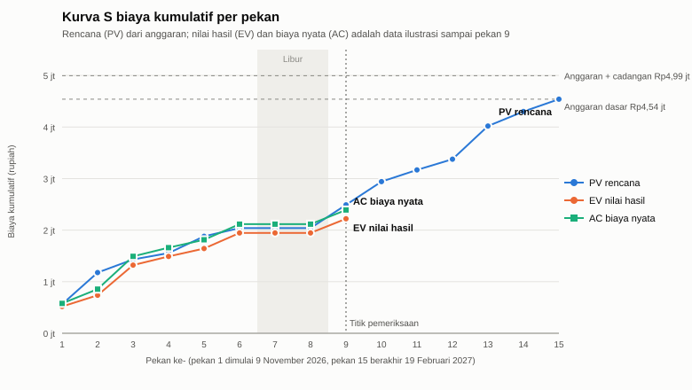

# Kurva S dan pengendalian biaya

Bab ini menjelaskan cara tim memantau apakah proyek berjalan sesuai rencana, baik dari sisi waktu maupun biaya. Alat yang dipakai adalah kurva S dan metode EVM (_Earned Value Management_), atau manajemen nilai hasil.

## Tiga angka yang dipantau

EVM membandingkan tiga angka setiap pekan:

| Angka | Nama                           | Arti sederhana                                               |
| ----- | ------------------------------ | ------------------------------------------------------------ |
| PV    | _Planned Value_, nilai rencana | Uang yang menurut rencana sudah terpakai sampai pekan ini    |
| EV    | _Earned Value_, nilai hasil    | Nilai anggaran dari pekerjaan yang benar-benar sudah selesai |
| AC    | _Actual Cost_, biaya nyata     | Uang yang benar-benar sudah dikeluarkan                      |

Contohnya, kalau pekerjaan dengan anggaran Rp100.000 baru selesai separuh, nilai hasilnya Rp50.000, berapa pun uang yang sudah keluar.

Dari tiga angka itu, tim menghitung dua indeks:

- **Indeks jadwal (SPI)** = EV ÷ PV. Kalau nilainya 1, proyek tepat jadwal. Di bawah 1 berarti terlambat, di atas 1 berarti lebih cepat.
- **Indeks biaya (CPI)** = EV ÷ AC. Kalau nilainya 1, biaya sesuai rencana. Di bawah 1 berarti boros, di atas 1 berarti hemat.

## Kurva S rencana

Kurva S adalah grafik biaya kumulatif dari pekan ke pekan. Kurva rencana (PV) disusun dari biaya setiap pekerjaan di bab estimasi biaya, dibagi rata ke hari-hari pengerjaannya sesuai jadwal di bab estimasi waktu, lalu dijumlahkan per pekan.

Kurva proyek ini tidak berbentuk huruf S yang mulus. Kurva naik tajam pada pekan-pekan kerja di kampus, karena bensin hanya dihitung pada hari-hari itu. Kurva mendatar di pekan 7 dan 8 karena libur akhir tahun. Bentuk ini wajar untuk proyek yang sebagian besar biayanya adalah uang saku dan bensin.

| Pekan | Mulai                    | PV pekan ini | PV kumulatif | EV kumulatif (ilustrasi) | AC kumulatif (ilustrasi) |
| ----- | ------------------------ | ------------ | ------------ | ------------------------ | ------------------------ |
| 1     | 9 November 2026          | 563.333      | 563.333      | 518.889                  | 580.000                  |
| 2     | 16 November 2026         | 613.333      | 1.176.667    | 736.667                  | 856.667                  |
| 3     | 23 November 2026         | 254.583      | 1.431.250    | 1.322.500                | 1.492.500                |
| 4     | 30 November 2026         | 125.000      | 1.556.250    | 1.490.208                | 1.660.208                |
| 5     | 7 Desember 2026          | 323.750      | 1.880.000    | 1.643.750                | 1.813.750                |
| 6     | 14 Desember 2026         | 160.000      | 2.040.000    | 1.945.000                | 2.115.000                |
| 7     | 21 Desember 2026 (libur) | 0            | 2.040.000    | 1.945.000                | 2.115.000                |
| 8     | 28 Desember 2026 (libur) | 0            | 2.040.000    | 1.945.000                | 2.115.000                |
| 9     | 4 Januari 2027           | 450.000      | 2.490.000    | 2.220.000                | 2.390.000                |
| 10    | 11 Januari 2027          | 450.000      | 2.940.000    |                          |                          |
| 11    | 18 Januari 2027          | 227.500      | 3.167.500    |                          |                          |
| 12    | 25 Januari 2027          | 207.500      | 3.375.000    |                          |                          |
| 13    | 1 Februari 2027          | 642.917      | 4.017.917    |                          |                          |
| 14    | 8 Februari 2027          | 282.083      | 4.300.000    |                          |                          |
| 15    | 15 Februari 2027         | 240.000      | 4.540.000    |                          |                          |

Semua angka dalam rupiah. Kurva rencana berakhir di Rp4.540.000, yaitu biaya dasar. Garis anggaran termasuk cadangan risiko, Rp4.994.000, menjadi batas atas yang tidak boleh dilewati tanpa persetujuan.

## Contoh pemantauan

Karena proyek belum berjalan, angka EV dan AC di atas adalah **data ilustrasi**. Tujuannya hanya untuk menunjukkan cara membaca EVM, bukan ramalan. Skenarionya:

- Izin dari kampus keluar 3 hari kerja lebih lambat dari perkiraan paling mungkin, sehingga pengajuan izin memakan 9 hari, bukan 6. Seluruh pekerjaan sesudahnya ikut bergeser 3 hari kerja.
- Satu hari pengukuran awal harus diulang oleh dua orang, sehingga ada tambahan uang saku dan bensin Rp60.000.

Pemeriksaan dilakukan di akhir pekan 9, yaitu 8 Januari 2027.

| Ukuran                                    | Nilai       | Arti                                                                     |
| ----------------------------------------- | ----------- | ------------------------------------------------------------------------ |
| PV                                        | Rp2.490.000 | Menurut rencana, pekerjaan senilai ini seharusnya sudah selesai          |
| EV                                        | Rp2.220.000 | Pekerjaan yang benar-benar selesai bernilai segini                       |
| AC                                        | Rp2.390.000 | Uang yang sudah keluar                                                   |
| Selisih jadwal (EV − PV)                  | −Rp270.000  | Ada pekerjaan senilai Rp270.000 yang belum selesai sesuai jadwal         |
| Selisih biaya (EV − AC)                   | −Rp170.000  | Uang yang keluar lebih besar Rp170.000 dari nilai pekerjaan yang selesai |
| SPI                                       | 0,89        | Proyek berjalan sekitar 11% lebih lambat dari rencana                    |
| CPI                                       | 0,93        | Setiap Rp1 yang keluar menghasilkan pekerjaan senilai Rp0,93             |
| Perkiraan biaya akhir (biaya dasar ÷ CPI) | Rp4.887.658 | Kalau pola ini berlanjut, biaya akhir sekitar Rp4,89 juta                |

Cara membacanya: proyek terlambat dan sedikit boros. Penyebab utamanya adalah izin yang terlambat, karena selama menunggu izin, uang saku tetap keluar tetapi pekerjaan belum maju. Perkiraan biaya akhir Rp4,89 juta masih di bawah batas anggaran termasuk cadangan, Rp4,99 juta. Artinya cadangan risiko cukup untuk menutup keterlambatan ini, dan proyek tidak perlu meminta tambahan dana. Dari sisi waktu, keterlambatan 3 hari kerja menggeser tanggal selesai dari 18 Februari menjadi 23 Februari 2027.

## Aturan tindakan

Tim mencatat ketiga angka setiap akhir pekan, lalu membahasnya lebih lengkap di setiap titik pemeriksaan yang tercantum di bab estimasi waktu. Aturan yang dipakai:

| Kondisi                                    | Tindakan                                                                                                                                                   |
| ------------------------------------------ | ---------------------------------------------------------------------------------------------------------------------------------------------------------- |
| SPI dan CPI 0,95 atau lebih                | Proyek dianggap sesuai rencana. Lanjutkan.                                                                                                                 |
| SPI di bawah 0,95                          | Manajer proyek mencari pekerjaan yang terlambat dan menyusun ulang jadwal pekan berikutnya, misalnya dengan menambah satu orang di pekerjaan jalur kritis. |
| CPI di bawah 0,95                          | Manajer proyek memeriksa pos yang boros, misalnya hari ke kampus yang bisa digabung.                                                                       |
| Perkiraan biaya akhir melewati Rp4.994.000 | Manajer proyek melapor kepada dosen pembimbing dan pengelola sebelum pekerjaan dilanjutkan.                                                                |

Dalam contoh di atas, SPI dan CPI sama-sama di bawah 0,95. Jadi manajer proyek perlu menyusun ulang jadwal dan memeriksa pos biaya, tetapi belum perlu melapor karena perkiraan biaya akhir masih di bawah batas anggaran.
